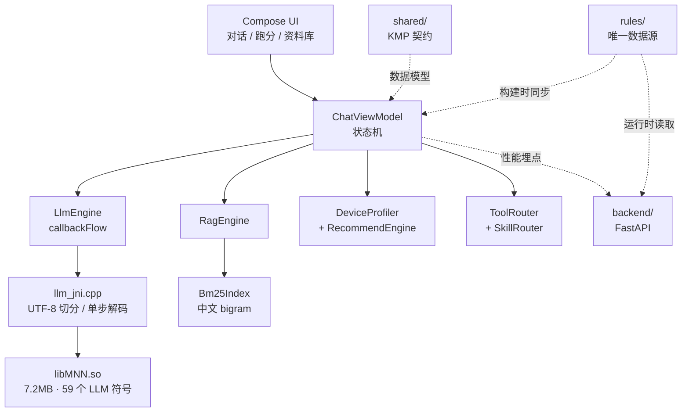

# LiteAgent

> 一个**完全离线**的手机 AI 助理：模型在本地、推理在本地、文档不出设备。

安卓端用 **MNN** 跑量化后的 Qwen2.5，配本地文档检索与设备自适应。技术栈：Kotlin + Compose / MNN(JNI) / KMP 共享契约 / FastAPI，单仓。

> 状态：**开发中**。核心链路（MNN 编译 → JNI → 流式 → 模型管理 → 推荐引擎 → BM25 检索 → 后端）已打通并通过单元测试；真机推理数字待补。

---

## 它解决什么问题

端侧小模型的聊天质量注定打不过云端。所以这个项目不把价值放在"能聊天"上，放在云端**架构上做不到**的两件事：

1. **文档不出设备**。手机里的方案、笔记、合同，AI 能读、能答、能指出"引自哪个文件第几段"，但一个字节都没上传过。云端产品做不到——要用你的文件，就必须先上传。
2. **没有边际推理成本**。对有亿级用户的工具类产品，这是一笔真实的账：单次推理成本从"每次调用几分钱"变成 0。

同一份 APK 还要能在 6GB 老机和 12GB 旗舰上都跑起来 — 端侧适配能力是"能不能真落地"的分水岭。

---

## 当前状态（诚实版）

| 模块 | 状态 | 说明 |
|---|---|---|
| MNN 编译 | ✅ | 自编译 `libMNN.so`，含 LLM 引擎，7.2MB |
| JNI 封装 | ✅ | 流式 + 可中断 + UTF-8 安全切分 |
| 模型管理 | ✅ | 断点续传 + SHA-256 校验，三模型自动选择 + 手动切换 |
| 设备探测 | ✅ | 真机验证过（含 EGL 取 GPU 型号） |
| 推荐引擎 | ✅ | 10 个边界用例，单测全绿 |
| 本地检索（BM25） | ✅ | 字级 bigram，6 个单测 |
| 文档分块 | ✅ | 按标题 + 按句累积 + 一句重叠，4 个单测 |
| RAG 全链路 | ✅ | 导入 → 分块 → 检索 → 带编号引用的回答，8 个单测 |
| 资料库界面 | ✅ | SAF 导入（不申请存储权限）、片段数、删除 |
| 后端 | ✅ | 4 个接口实测通过 |
| 跑分页 | ✅ | 3 条固定 prompt，可导出 JSON / 复制 Markdown |
| 工具调用 | ✅ | 3 个：设置提醒 / 读剪贴板 / 读今日日程。JSON 约束输出 + 解析 + 回灌 |
| Skills | ✅ | 3 个 Markdown，关键词触发，不引入引擎 |
| 会话管理 | ✅ | 多会话持久化、切换、删除、导出 Markdown |
| 人格预设 | ✅ | 助理 / 翻译 / 代码 / 总结（借鉴 PocketPal 的 Pals）|
| **真机推理** | ✅ | DNAKE v911（**1950MB**）跑通 0.5B，decode 3.7 tok/s |

---

## 架构

```
app-android/
├── ui/            Compose 聊天页（流式渲染、停止按钮）
├── engine/        LlmEngine —— JNI 的 Kotlin 封装，callbackFlow 对外
├── capability/    DeviceProfiler（探测）+ RecommendEngine（推荐）
├── data/          ModelStore（文件管理）+ ModelDownloader（续传/校验）
├── rag/           TextChunker（分块）+ Bm25Index（检索）
└── cpp/           llm_jni.cpp —— 唯一直接碰 MNN 的地方
shared/            KMP 契约：ChatMessage / DeviceProfile / PerfReport …
backend/           FastAPI：模型清单、推荐、性能埋点（不做推理）
rules/             设备分级规则 —— **客户端与后端的唯一数据源**
tools/             build_mnn_android.sh / download_model.sh
docs/              调研与决策记录
```



---

## 关键设计决策

### 1. 为什么用 MNN，代价是什么

热门端侧项目几乎全走 llama.cpp + GGUF，MNN 做端侧 LLM Agent 的开源实现很少。MNN 在中文小模型上有官方预转换权重，且 LLM 引擎自带性能计数器。

代价是**必须自己编译**：MNN 主仓库不发布 Android 预编译 `.so`（`libs/`、`jniLibs/` 都是空的）。实测在 Windows + NDK 28 上用 Ninja 编译 3m39s，详见 `docs/00-research.md`。

### 2. 流式为什么不是回调，而是"单步解码"

MNN 没有 `setCallback` 这种 API，唯一入口是 `response(prompt, std::ostream*, end_with, max_new_tokens)`，一次调到底。

如果直接这么用，**停止按钮是假的**——用户点了要等模型吐完。

正确写法是两段式：

```cpp
response(messages, &os, "<eop>", 0);   // max_new_tokens=0，只做 prefill
while (!stop) { generate(1); }          // 一个 token 一次，间隙可退出
```

最坏停止延迟 = 一个 token 的解码时间。这个细节官方文档里没有。

### 3. 中文检索为什么用字级 bigram，而不是分词

jieba 类分词库要带 5MB 词典，APK 体积是硬成本。"量化精度" 切成 `量化 / 化精 / 精度`，在 BM25 上召回接近分词，还顺手绕掉了 OOV（型号名、专有名词）问题。

这是一个有代价的取舍：专业术语密集的语料上，分词仍会更好。等接入 embedding 做混合检索时再评估。

### 4. 规则表只有一个数据源

`rules/recommend-rules.json` 是唯一真相：客户端构建时同步进 assets 做回落，后端运行时读同一个文件做下发。两端算法同构，靠同一组边界用例约束。

不这么做的话，一定会出现"客户端说 1.5B、后端说 3B"的漂移。

### 5. 装不下就明确拒绝

探测到 2GB 内存的设备，直接告诉用户"这台设备跑不了"，而不是硬推 0.5B 然后等进程被系统杀掉。优雅降级 ≠ 硬撑。

这条规则来自实测：公司一台 Allwinner A537 工控机（1950MB / Mali-G57 / API 35）连 0.5B 都放不下。

### 6. 内存分档必须做标称补偿

`ActivityManager.MemoryInfo.totalMem` 永远比标称小 0.4–0.8GB。直接拿它比"6GB/8GB/12GB"阈值，6GB 机会被降级、`>=12GB` 那一档永远命中不了。

实现上先 `+0.6GB` 补偿再就近归并到 `{4,6,8,12,16}` 档位。`RecommendEngineTest` 里 10 个用例专门钉这件事。

---

## 实测数据（截至目前）

| 项 | 数值 | 备注 |
|---|---|---|
| MNN 编译 | 3m39s（8 线程） | 含 LLM 引擎 |
| `libMNN.so` | 7.2 MB | 59 个 `Llm::` 符号 |
| `libliteagent_llm.so` | 76 KB | 自写 JNI |
| APK（debug） | 24 MB | 不含模型 |
| APK（release + R8） | **8.4 MB** | 其中 `libMNN.so` 7.2MB，占 86% |
| Qwen2.5-0.5B W4 | 531 MB | 7 个文件，含独立 embedding |
| 单元测试 | 45 个全绿（客户端）+ 13 个（后端） | 推荐 10 / BM25 6 / RAG 8 / 分块 4 / 工具解析 12 / 技能 5 |

**还没有**首 token 延迟——`ttfa_us` 在我们这条路径上没被填充，待修。

### 真机实测（DNAKE v911 · Allwinner A537 · 1950MB · Android 15）

| 指标 | 值 |
|---|---|
| 模型 | Qwen2.5-0.5B W4 · 3 线程 · 1K 上下文 · mmap |
| 加载 | 6498 ms |
| 首 token | 230 / 656 / 1347 ms（短/中/长 prompt） |
| prefill | 4.4 / 13.8 / 15.1 tok/s |
| decode | **8.2 / 8.5 / 8.3 tok/s** |
| 内存峰值 | **688 MB**（可用 692 MB，99%） |
| 系统影响 | 加载期间 LMK 杀掉 7 个后台进程，本进程存活 |
| **release 包** | ✅ 已装机验证（R8 混淆后加载 3976 ms、首 token 2268 ms、decode 5.9 tok/s）|

三个结论：

1. **decode 8.3 t/s 是稳定值**，不随输入长度变化——一个汉字约 120ms，可用。
2. **prefill 只有 15 t/s**，1000 字文档要 67 秒。这才是 RAG 场景的瓶颈，所以这台设备上「仅检索模式」常常是更优解，不只是兜底。
3. **内存 688/692 MB，没有余量。** 再多开一个应用就可能被杀。

**1.5B 也测了**：加载 13.3s、首 token 5789ms、decode **3.0 t/s**、RSS **988MB**。**没有 OOM**——mmap 按页调入 + zram swap 让它跑完了，但慢到不可用。两次误判的复盘在 [`docs/plan-low-end-device.md`](docs/plan-low-end-device.md)。

截图证据：[极限模式](docs/assets/low-end-device-extreme-mode.png) · [首次出字](docs/assets/low-end-device-first-token.png) · [跑分结果](docs/assets/low-end-device-benchmark.png)

这是**一台 2GB 设备**。0.5B 的词嵌入走 MNN 的 `DiskEmbedding` 不占内存，所以权重之外的大头不进 RAM——详见 [`docs/plan-low-end-device.md`](docs/plan-low-end-device.md)。

---

## 怎么跑

### 1. 编译 MNN（只需一次）

```bash
# 需要 NDK 28 + CMake 3.30（Android SDK 里自带）
bash tools/build_mnn_android.sh
```

产物 `libMNN.so` 会自动落在 `app-android/src/main/jniLibs/arm64-v8a/`。

### 2. 构建 APK

```bash
./gradlew :app-android:assembleDebug
adb install -r app-android/build/outputs/apk/debug/app-android-debug.apk
```

### 3. 模型

App 内置下载入口（按推荐自动选 0.5B / 1.5B / 3B，断点续传 + SHA-256 校验），对话页可手动切换模型。也可以手动：

```bash
bash tools/download_model.sh
adb push models/Qwen2.5-0.5B-Instruct-MNN /sdcard/Android/data/com.liteagent.app.debug/files/models/
```

### 4. 后端

```bash
cd backend
pip install -r requirements.txt
uvicorn app.main:app --port 8077
```

---

## 设备分级规则

| 实测总内存 | 归并档位 | 模型 | 下载体积 | 上下文 | 策略 |
|---|---|---|---|---|---|
| < 1.5 GB | — | — | — | — | **明确拒绝** |
| 1.5–3.5 GB | 极限 | Qwen2.5-0.5B W4 | 531 MB | **1K** | 强制 mmap · 关 GPU · 3 线程 |
| ~3.5 GB | 4 GB | Qwen2.5-0.5B W4 | 531 MB | 2K | 稳定优先 |
| ~5.6 GB | 6 GB | Qwen2.5-1.5B W4 | 839 MB | 3K | 体验平衡 |
| ~7.5 GB | 8 GB | Qwen2.5-1.5B W4 | 839 MB | 4K | 主力档位 |
| ~11.4 GB | 12 GB | Qwen2.5-3B W4 | 2.2 GB | 4K | 质量优先 |
| ~15.5 GB | 16 GB | Qwen2.5-3B W4 | 2.2 GB | 4K | 3B 仍是甜点 |

三个模型的文件组成并不相同：0.5B 与 3B 带独立的 `embeddings_bf16.bin`（260MB / 593MB），1.5B 没有。清单里每个模型的文件列表和 sha256 都是按仓库实际内容生成的，不能套模板。

GPU 判断：GLES ≥ 3.0 且 GL_RENDERER 命中 Adreno/Mali/Immortalis 前缀。MNN 走 OpenCL，Android 没有公开的 OpenCL 查询 API，只能这样保守推断。

---

## 文档

| 文件 | 内容 |
|---|---|
| [`docs/00-research.md`](docs/00-research.md) | MNN 真实 API 契约、集成路径对比、编译实测 |
| [`docs/FEATURES.md`](docs/FEATURES.md) | **功能说明书**：每个功能怎么用、前置条件、失败表现、数据在哪 |
| [`docs/01-code-review.md`](docs/01-code-review.md) | 首轮自审 9 条（2 条 P0）|
| [`docs/03-code-review-2.md`](docs/03-code-review-2.md) | 次轮自审 7 条（3 条 P1，全是并发与数据丢失）|
| [`docs/04-rag-e2e.md`](docs/04-rag-e2e.md) | **RAG 端到端真机验证**：6 个断言全过，含引用标注 |
| [`docs/02-performance.md`](docs/02-performance.md) | 包体积实测（24MB → 8.4MB）、启动路径、R8 两个坑 |
| [`docs/adr/`](docs/adr/README.md) | 5 篇架构决策记录，每篇含"放弃了什么" |
| [`docs/vibe/`](docs/vibe/README.md) | 5 个真实 AI 协作案例（全是失败案例）|
| [`docs/blog/`](docs/blog/01-build-mnn-on-windows.md) | 两篇技术博客草稿 |
| [`AGENTS.md`](AGENTS.md) / [`CLAUDE.md`](CLAUDE.md) / [`.cursor/rules/`](.cursor/rules/project.mdc) | 三种 AI 工具的规则文件 |

## 协作记录

本项目全程用 AI 辅助开发（Cursor / Claude Code 类工具），5 个真实的踩坑案例记录在 [`docs/vibe/`](docs/vibe/README.md)。
全部是失败案例——因为成功案例只能证明"AI 能用"，失败案例才说明在哪里刹住了它。

| # | 案例 | 教训 |
|---|---|---|
| 01 | AI 编造了一个不存在的头文件 | 半真半假的幻觉最难发现 |
| 02 | BUILD SUCCESSFUL，但库是空的 | 编译通过是最弱的验收标准 |
| 03 | 停止按钮是假的 | 要问"哪个循环退出了" |
| 04 | 8GB 手机被推荐 0.5B | 规则在纸面上永远是对的 |
| 05 | 中文流式变方块 | 隐性假设只在中文场景暴露 |

这些教训没有停在文档里，而是变成了 `AGENTS.md` 的硬约束和 42 个单元测试。

## 已知限制
- **真机推理未验证**：所有性能数字待补。
- GPU 路径未验证：OpenCL 在不同 SoC 上的实际加速比未知，可能负优化。
- 7B 默认不推荐：12GB 机上峰值内存会逼近系统 LMK 阈值。
- PDF 只支持文本层：扫描件需要 OCR，不在范围内。
- 分词取舍：bigram 对专有名词友好，对长术语精确匹配不如词典分词。

---

## 不做的事

账号体系、云同步、无障碍 UI 自动化、图像生成、语音唤醒、多云端 provider。

这些不是做不了，是做不完——四周内把核心链路做扎实，比铺开六个半成品有价值。
